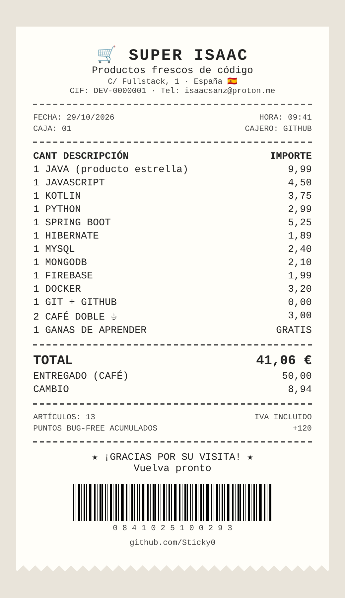

<div align="center">

# 🛒 SUPERMERCADO ISAAC 🛒

### *"Productos frescos de código, cada día"*

```
╔══════════════════════════════════════╗
║        🛒  S U P E R   I S A A C  🛒       ║
║   Fullstack Developer · Spain 🇪🇸          ║
║──────────────────────────────────────║
║   ABIERTO 24H · SIEMPRE APRENDIENDO   ║
╚══════════════════════════════════════╝
```

</div>

---

## 📝 MI LISTA DE LA COMPRA

> Esto es lo que llevo siempre en el carro:

### 🥩 Sección Carnicería (Lenguajes)
- [x] ☕ Java &nbsp;·&nbsp; *el producto estrella*
- [x] 🟨 JavaScript
- [x] 🟣 Kotlin
- [x] 🐍 Python
- [x] 🐘 PHP
- [x] ⚙️ C / C++
- [x] 🌐 HTML5
- [x] 🐚 Shell Script y PowerShell

### 🥦 Sección Frutería (Frameworks y librerías)
- [x] 🍃 Spring
- [x] 💤 Hibernate
- [x] 🎨 JavaFX
- [x] 🎼 Symfony
- [x] 🅰️ AngularJS
- [x] 🅱️ Bootstrap
- [x] 📰 WordPress

### 🧀 Sección Lácteos (Bases de datos y cloud)
- [x] 🐬 MySQL
- [x] 🍃 MongoDB
- [x] 🪶 SQLite
- [x] 🔥 Firebase
- [x] ☁️ AWS

### 🧰 Sección Droguería (Herramientas)
- [x] 🌿 Git y GitHub
- [x] 🪣 Bitbucket
- [x] 📋 Jira
- [x] 🐳 Docker
- [x] 🪶 Apache
- [ ] 🎯 *Pendiente de comprar: lo que toque aprender mañana*

<details>
<summary>🏷️ Ver etiquetas de precio (badges)</summary>
<br/>


</details>

---

## 🧾 TICKET DE COMPRA

<div align="center">

<a href="assets/ticket.pdf"></a>

<sub>Se genera solo cada día con los lenguajes de mis repositorios · <a href="assets/ticket.pdf">Descargar en PDF</a></sub>

</div>

## 📞 ATENCIÓN AL CLIENTE

<div align="center">

<a href="https://www.linkedin.com/in/isaacsanz"></a>
<a href="https://leetcode.com/isaac-sanz/"></a>
<a href="mailto:isaacsanz@proton.me"></a>

</div>

---

## 📊 OFERTAS DE LA SEMANA (GitHub Stats)

<div align="center">


</div>


---

<div align="center">

### 💬 Frase del día (cartel de la entrada)


<br/>

🛒 **¡Gracias por su visita! Vuelva pronto.** 🛒

<a href="https://visitcount.itsvg.in"></a>

</div>

<!-- Proudly created with GPRM ( https://gprm.itsvg.in ) -->
