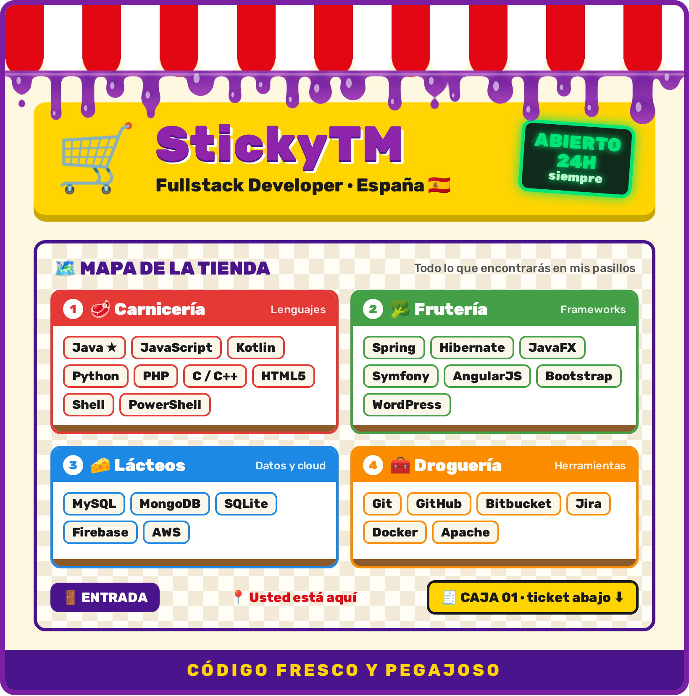
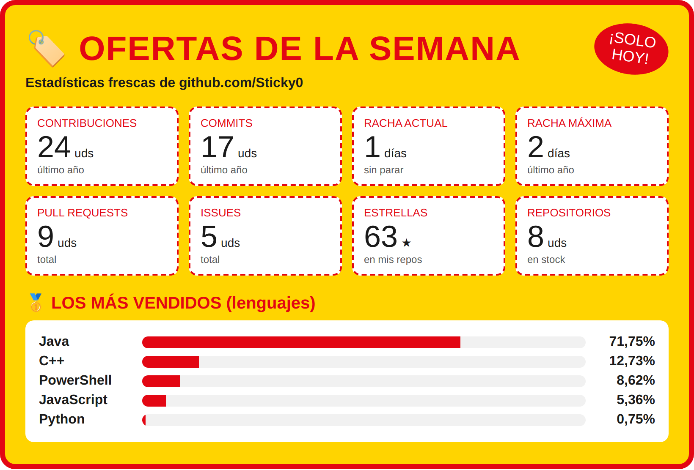

  

---

## ⭐ Productos destacados

Mis repositorios pineados, recién salidos del horno

<!--START_SECTION:destacados-->
<!--END_SECTION:destacados-->

---

## 🏷️ Ofertas de la semana

Mis estadísticas de GitHub, actualizadas cada día

---

## 🧾 Caja · Ticket de compra

Lo que pesa cada lenguaje en mis repositorios

<a href="assets/ticket.pdf">📄 Descargar el ticket en PDF</a>

---

🛒 **¡Gracias por su visita! Vuelva pronto.** 🛒

